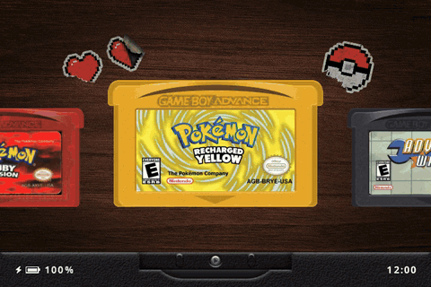

<div align="center">


<a href="LICENSE"></a>
<a href="https://github.com/BrandonKowalski/slot/stargazers"></a>
<a href="https://github.com/BrandonKowalski/slot/releases"></a>
<a href="https://slot-cfw.fyi"></a>
<a href="CHANGELOG.md"></a>

</div>

---

# About this fork

This is [nickclyde/slot](https://github.com/nickclyde/slot), a fork of
[BrandonKowalski/slot](https://github.com/BrandonKowalski/slot) that adds
**[RetroAchievements](https://retroachievements.org)** and a home **Wi-Fi** client.
Everything else is upstream slot, and the fork is kept in sync with it.

What it adds:

- Sign in to RetroAchievements from a text file on the card. After the first sign-in slot swaps your
  password for a login token.
- Insert a cart and slot identifies the game and shows how many achievements you have.
- Every unlock pops up at the bottom of the screen with its badge. Unlocks earned offline are sent once
  you are back online.
- Softcore only, so resume-on-insert, rewind and Polaroids keep working as usual.
- Joins your home network from `Config/wifi.txt`, and steps aside while link play uses the radio.

## Using the fork

There are no prebuilt releases of the fork yet, so build the card from source on macOS or Linux with
[Task](https://taskfile.dev) and Docker installed:

```sh
git clone https://github.com/nickclyde/slot.git
cd slot
task dist:device
```

This produces `dist-device/`, the same SD2 tree as an upstream release. Set the card up as in the
[guide](https://slot-cfw.fyi): BaseOS on the card in SD1, and a second card formatted FAT32 with a Master
Boot Record in SD2. Copy the contents of `dist-device/` onto the second card, then add your games.

On the second card, fill in two files in `Config/`:

```ini
# Config/wifi.txt
ssid = My Home Network
psk = my wifi password
```

```ini
# Config/retroachievements.txt
username = YourName
password = your password
```

Boot, insert a cart, and play. If something does not work, `slot.log` at the root of the card has
`slot: wifi:` and `slot: cheevos:` lines explaining why. More detail, including static IP settings, is in
[site/retroachievements.html](site/retroachievements.html). How the fork is put together and how to sync
it with upstream is in [FORK.md](FORK.md).

---

# What is slot?

A bespoke, Game Boy-centric frontend for the Anbernic RG SP.

Has support for GBA, GBC, and GB titles only.

> [!IMPORTANT]
> ROMs must be unzipped. slot does not read `.zip` or `.7z` files.

A full user guide can be found at [slot-cfw.fyi](https://slot-cfw.fyi).

Release notes can be found in the [changelog](CHANGELOG.md).

---

# What does it look like?

<p align="center">


</p>

<p align="center">

</p>

---

# Supported Devices

| Device             | Supported                  | Since Version |
|--------------------|----------------------------|---------------|
| Anbernic RG SP     | Yes                        | Always        |
| Anbernic RG34XX    | Yes                        | 1.4.0         |
| Anbernic RG34XXSP  | Yes (No Stick Support Yet) | 1.4.0         |
| Anbernic RG35XXSP  | Yes                        | 1.5.0         |
| Anbernic 35XX Plus | Yes                        | 1.5.0         |

The RG34XX will likely work from 1.4.0. The RG34XXSP may not map its sticks correctly.

If you have one of the Untested devices, or have tried slot on a device not listed,
please [open an issue on GitHub](https://github.com/BrandonKowalski/slot/issues) and let me know how it went.

---

# AI Disclosure

The Rust frontend was put together by Claude Opus. I reviewed everything that was
produced. All documentation is 100% free-range, meatbag prose.

The project is extremely low stakes. I wanted a bespoke frontend for my RG SP and thought
that something that evokes the feeling of using my GBA SP as a kid would be pretty neat.

Use it, don't use it, I don't care.

Figured I should share the end result of all the wasted water. ✌🏻
